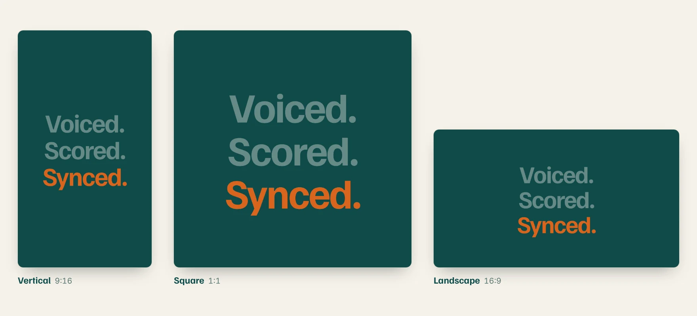
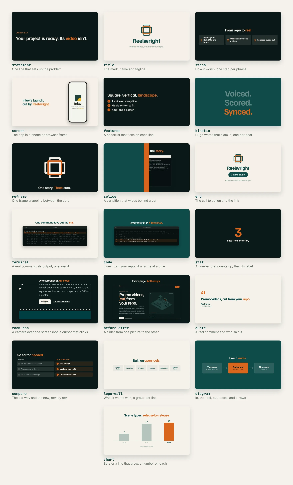

<p align="center">
  <a href="https://mattblack.space/skills/reelwright/">
    <picture>
      <source media="(prefers-color-scheme: dark)" srcset=".github/readme/logo-dark.svg" />
      
    </picture>
  </a>
</p>

<h3 align="center">Promo videos, cut from your repo.</h3>

<p align="center">
  A Claude Code plugin that turns a project's repo and brand into a short launch video:<br />
  square and vertical for social with burned-in captions, landscape for the web, a GIF for the README and a poster frame.
</p>

<p align="center">
  <a href="https://mattblack.space/skills/reelwright/"><b>Website</b></a> ·
  <a href="#install">Install</a> ·
  <a href="#how-it-works">How it works</a> ·
  <a href="skills/reelwright/references/story.md">Story format</a> ·
  <a href="CHANGELOG.md">Changelog</a>
</p>

<p align="center">
  <a href="LICENSE"></a>
  <a href="CHANGELOG.md"></a>
  <a href="https://github.com/mtblck/claude-marketplace"></a>
  <a href="https://www.remotion.dev/"></a>
  <a href="https://mattblack.space/skills/reelwright/"></a>
</p>

<p align="center">
  <a href="https://mattblack.space/skills/reelwright/"></a>
</p>
<p align="center"><sub>Reelwright's own promo, made with Reelwright. Sound on at <a href="https://mattblack.space/skills/reelwright/">mattblack.space/skills/reelwright</a>.</sub></p>

## What it does

Ask Claude for a video and it reads the repo, captures the running app, writes a story of five to seven
scenes and renders it. A voiceover reads every line, and each reveal on screen lands on the word that
names it. The music bed is written to the video's exact length, and the sound effects come with the
plugin, so there is nothing to license or credit.

It runs in Claude's cloud sessions as they are: no API keys, and no setup beyond about 700 MB of cached
downloads on first use.

## Three cuts from one story

Every scene is laid out for each shape, not cropped from one, so the same story renders as all three.

<p align="center">
  <picture>
    <source media="(prefers-color-scheme: dark)" srcset=".github/readme/cuts-dark.webp" />
    
  </picture>
</p>

| You get | Size | For |
| --- | --- | --- |
| `<name>-vertical.mp4` | 1080 × 1920 | Reels, Shorts, TikTok, Stories |
| `<name>-square.mp4` | 1080 × 1080 | Feeds on X, LinkedIn, Instagram |
| `<name>-portrait.mp4` | 1080 × 1350 | Instagram and LinkedIn feeds (4:5, with `--formats portrait`) |
| `<name>-landscape.mp4` | 1920 × 1080 | Websites, YouTube, slides |
| `<name>.gif` | 540 wide | READMEs and docs (made from the first format in `--formats`) |
| `<name>-<format>.srt`, `.vtt` | Text | Subtitles to upload with each cut |
| `<name>-poster.png` | Size of the first format | Video player poster and thumbnails |

Every video is mixed to -14 LUFS, the loudness the social platforms play at.

## Install

From the [mtblck marketplace](https://github.com/mtblck/claude-marketplace):

```
/plugin marketplace add mtblck/claude-marketplace
/plugin install reelwright@mtblck
```

or on its own: `/plugin install reelwright --marketplace mtblck/reelwright`.

To have it in every cloud session on a repo, add `"reelwright@mtblck": true` to `enabledPlugins` in
that repo's `.claude/settings.json`.

## Use

Just ask:

- "Make a launch video for this app."
- "A 20-second vertical for the new export feature."
- "A GIF for the README."

Before the full render, Claude checks a contact sheet with one still per scene and fixes the story
until nothing is cut off or crowded, so the slow part only runs once.

## Scenes

A story is a list of scenes in `story.json`. Each scene has its lines (`say`), a background from the
brand and a way in: `cut`, `slide`, `fade`, `zoom`, `splice`, `push`, `mask`, `whip`, `glitch` or `match`.

<p align="center">
  <picture>
    <source media="(prefers-color-scheme: dark)" srcset=".github/readme/scenes-dark.webp" />
    
  </picture>
</p>

`terminal` and `code` are for projects with no app to film: a real command's output, recorded by
`scripts/term.mjs`, and lines from a file in the repo. `zoom-pan` walks a camera over one screenshot, and a cursor
can click through it. The proof scenes (`quote`, `compare`, `before-after`, `logo-wall`, `chart`) only take real material. Every scene, its props and the
story templates (App launch, Feature demo, Tool explainer, Dev tool and Hype) are in
[`references/story.md`](skills/reelwright/references/story.md).

## How it works

1. **Gather.** The README, the site's copy and the brand: a [brand-kit](https://github.com/mtblck/brand-kit)
   `brand.json` when there is one. `capture.mjs` takes screenshots and a screen clip of the running app
   with Playwright.
2. **Story.** Claude writes five to seven scenes in `story.json`. Each scene's lines are a list of phrases.
3. **Build.** Each phrase is voiced with [Kokoro](https://github.com/thewh1teagle/kokoro-onnx) on the
   CPU, and the timeline puts each reveal where its phrase starts. `music.mjs` writes a bed to the exact
   length, and sound effects land on the moves: a whoosh on each transition, ticks on list reveals, a
   chime on the end button.
4. **Render.** [Remotion](https://www.remotion.dev/) renders all three shapes from the same scenes.
   FFmpeg normalises the loudness and makes the GIF and poster.

| Needs | |
| --- | --- |
| Node 20+, FFmpeg, Python 3.9+ | Preinstalled in Claude's cloud sessions |
| Network on first run | npm, PyPI, GitHub releases, Google Fonts |
| Disk | About 700 MB in `~/.cache/reelwright` |

## Try the example

[`skills/reelwright/examples/inlay/`](skills/reelwright/examples/inlay) is the story behind Inlay's
launch video, with its brand and screen clip:

```bash
cp -R skills/reelwright/examples/inlay /tmp/inlay-video
node skills/reelwright/scripts/build.mjs /tmp/inlay-video
node skills/reelwright/scripts/render.mjs /tmp/inlay-video --formats square,vertical,landscape
```

## How the repo is laid out

```
skills/reelwright/
  SKILL.md         what Claude follows, step by step
  references/      story.json: every scene, its props and the templates
  scripts/         setup, capture, build, music, render
  template/        the Remotion project the scenes live in
  assets/sfx/      the sound effects (made by scripts/make-sfx.sh)
  examples/inlay/  a finished story to copy
brand/             Reelwright's own brand kit (logos, colours, type, guidelines)
.github/readme/    the images on this page
```

## Changelog

What changed, newest first, is in [CHANGELOG.md](CHANGELOG.md). A pull request that changes the plugin
adds its line under **Unreleased**; a release moves those lines under the new version and bumps
`version` in `.claude-plugin/plugin.json`.

## License

The code is [MIT](LICENSE). The sound effects and generated music are also CC0, so videos made with
them need no credit. Remotion is free for individuals and companies of up to 3 people; larger
companies need a [Remotion licence](https://www.remotion.dev/license). See
[THIRD_PARTY_NOTICES.md](THIRD_PARTY_NOTICES.md).

The Reelwright name and logos, and everything in `brand/`, are not covered by the MIT licence; see
[`brand/LICENSE`](brand/LICENSE) and [`brand/TRADEMARKS.md`](brand/TRADEMARKS.md).
